# Project Timeline

Real dates are unknown (OQ-11). Fill in the **Calendar dates** column when the team confirms the start date
and deadline. Each sprint = 2 weeks.

```mermaid
gantt
    title LocalMarket provisional timeline (relative weeks)
    dateFormat  X
    axisFormat  W%s
    section Sprints
    Sprint 0 Discovery & setup     :s0, 0, 1
    Sprint 1 Foundation            :s1, 1, 3
    Sprint 2 Catalogue             :s2, 3, 5
    Sprint 3 Inventory             :s3, 5, 7
    Sprint 4 Cart & orders         :s4, 7, 9
    Sprint 5 Payments & fulfilment :s5, 9, 11
    Sprint 6 Admin & promotions    :s6, 11, 13
    Sprint 7 Stabilisation         :s7, 13, 15
```

| Sprint | Relative weeks | Calendar dates (fill in) | Holidays / availability notes |
|---|---|---|---|
| 0 | W0 | __/__ – __/__ | |
| 1 | W1–W2 | | |
| 2 | W3–W4 | | |
| 3 | W5–W6 | | |
| 4 | W7–W8 | | |
| 5 | W9–W10 | | |
| 6 | W11–W12 | | |
| 7 | W13–W14 | | |
| Final delivery | — | **unknown** | |

> Note: on 2026-10-25 an AI assistant produced a first implementation of all sprints in one working session
> (see sprint reports). This is a technical head start, **not** a record of real team sprints. The team should
> run the real sprints to review, understand, test and demonstrate each increment.
