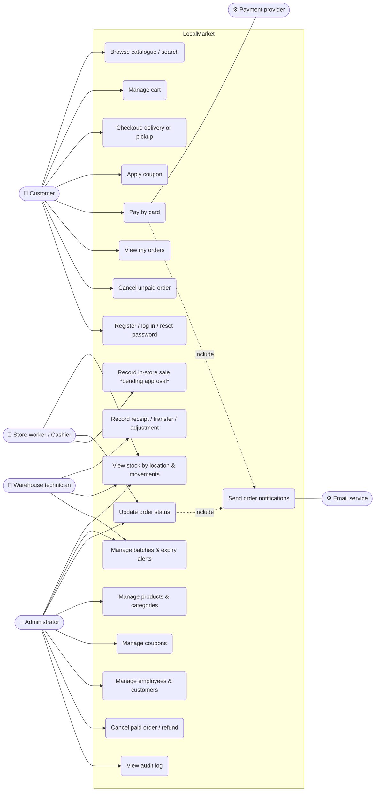

# 01 — Use Case Diagram

Mermaid has no native UML use-case shape, so actors are drawn as nodes and use cases as rounded boxes.

**Notes**
- All staff use cases require login; the server checks the role on every request (`role` middleware).
- UC14 is implemented in a simple form and is flagged as *pending client approval* (OQ-02).
