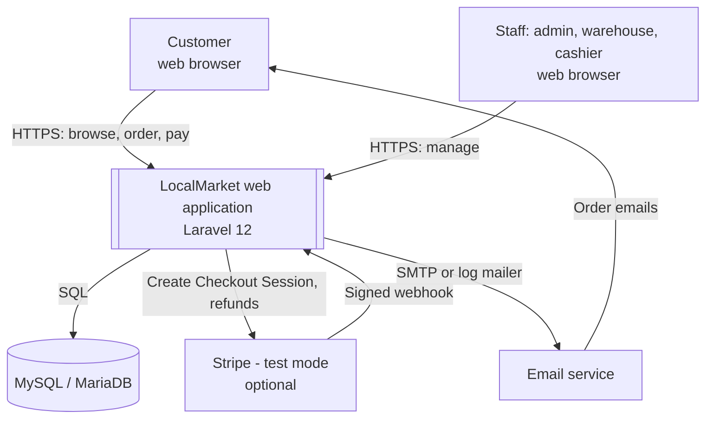

# 02 — System Context Diagram

**Notes**
- Stripe is used only when `PAYMENT_DRIVER=stripe`; otherwise the internal mock gateway is used.
- In development the mailer is `log` (emails are written to `storage/logs/laravel.log`).
