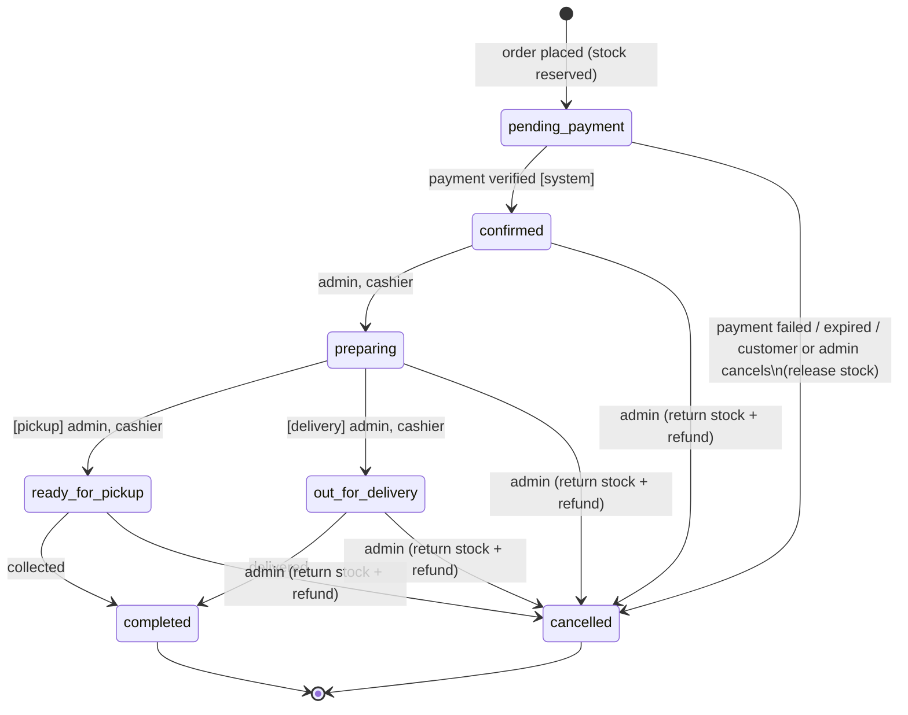

# 09 — State Diagram: Order lifecycle

Implemented in `App\Models\Order::TRANSITIONS` and `App\Services\OrderService::changeStatus()`.
Payment status (`pending → paid | failed`, `paid → refunded`) is stored separately in `orders.payment_status`.
