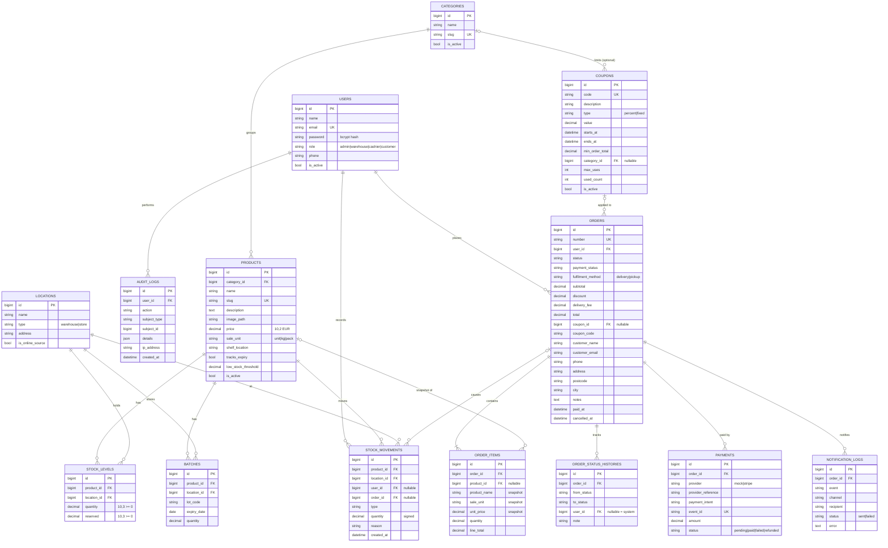

# 10 — Entity Relationship Diagram

Unique constraints: `stock_levels(product_id, location_id)`, `notification_logs(order_id, event, channel)`,
`payments.event_id`, `orders.number`, `coupons.code`, `products.slug`, `categories.slug`, `users.email`.
