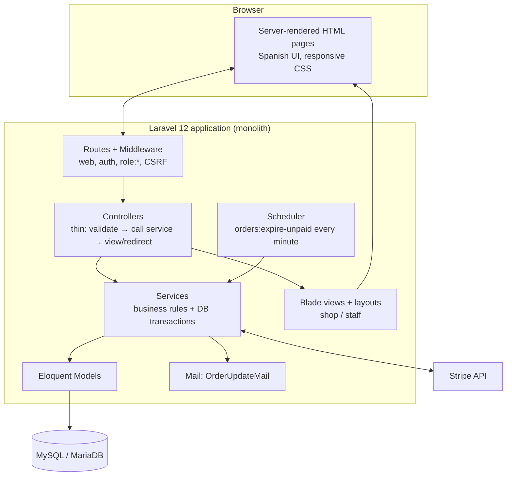

# 12 — Architecture Diagram

**Layers & rules**
1. Controllers never update stock or order status directly — they call a service.
2. Services wrap multi-step changes in `DB::transaction()` and lock rows they modify.
3. Views only format data (`eur()`, `qty()` helpers in `app/helpers.php`).
