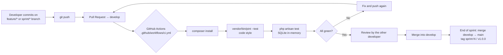

# 13 — CI/CD Workflow

**Status:** the workflow file exists in the repository. It runs only after the repository is pushed to GitHub
(no remote configured yet — see `PROJECT_STATUS.md`). Deployment is manual (see Deployment Guide).
